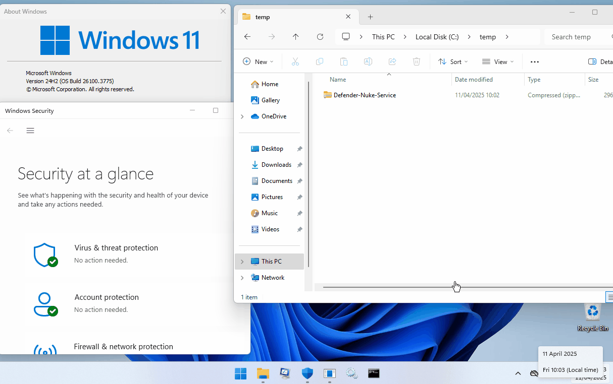

  

# Intro

Useful if have a need to disable defender but are unable to access the the system while it’s in safe mode/need the ability to perform an unattended nuke (e.g remote VM on a VPS).

## Summary

- The user account must be called “admin” / a local administrator privileged account called “admin” must exist on the system
- The contents of the zip need to be placed within c:\temp\
- You need to have local admin rights on the machine (obvs)

Tested and confirmed fully working on:

- Windows 11 Version 24H2 Build 26100.34
- Windows 11 Version 24H2 Build 26100.3476
- Windows 11 Version 25H2 Build 26200.9457

## Instructions

- Download the zip in the repo (_Final Files\Windows Defender Nuke (Service).zip)
- Extract the contents to C:\temp\
- Run the vbs script **‘Windows Defender Nuke (Service).vbs”**
- Let the system go into safe mode to do it’s thing
- The machine should reboot back into normal mode within a minute
- RDP back on the device with the new password that has been set (the new password is in the text file inside the zip)
- Reset the password back to whatever you want for admin: `net user admin <yourpassword>`.

## What does it do?

The vbs along with the custom binary will do the following:

- Removes the password on the account “admin”
- Creates a service using NSSM called “WindowsDefenderNukeService” using WindowsDefenderNukeServices.exe
- Adds a registry key entry to boot the service in safe mode
- Sets the system into safemode and reboots
- Once in safemode the service WindowsDefenderNukeService starts WindowsDefenderNukeServices.exe
- Defenders registry keys are modified
- Bootmode is set back to normal
- Resets the password on the account “admin” to hj7gdn@!x
- Removes the registry key entry for the service to start in safe mode
- Stops and deletes the service WindowsDefenderNukeServices
- Reboots the system within 10 seconds

The source code for the binary WindowsDefenderNukeService is included within the repo if you want to make it even fancier.

Enjoy!

[CyberOps.Team_ Blog](https://blog.cyberops.team)
